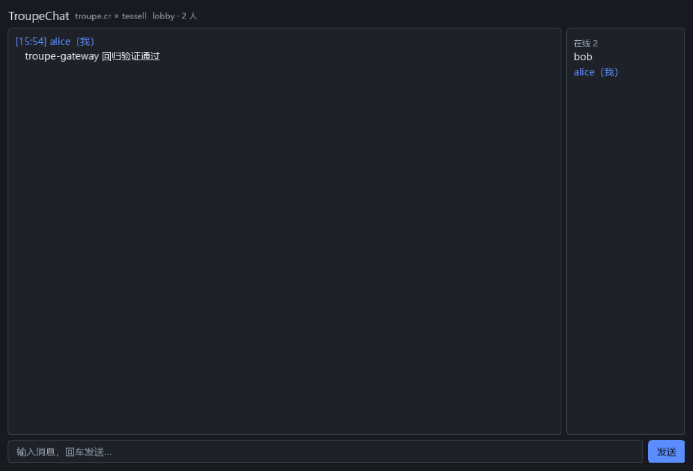

# TesselChat

TroupeChat 的**客户端**：[`tessell`](https://github.com/ShiningRay/tessell) retained
自绘 GUI —— Kit 组件（Button/Input/Text）+ 自绘聊天记录（换行/吸底/滚轮翻阅），
SDL2 + OpenGL 宿主，WebSocket 收发走后台纤程、每帧泵入 UI。

对接任意 TroupeChat 服务端实现（协议一致，见
[troupe-chat 服务端 monorepo](https://github.com/ShiningRay/troupe-chat)）：

| 服务端 | 仓库内目录 | 运行时 |
|---|---|---|
| Crystal | `crystal/` | troupe-cr + troupe-gateway |
| Ruby | `ruby/` | troupe-rb |
| JavaScript/TS | `js/` | troupe-js |
| Go | `go/` | troupe-go |
| Elixir | `elixir/` | troupe-elixir（规划中） |

协议见服务端仓 [docs/protocol.md](https://github.com/ShiningRay/troupe-chat/blob/main/docs/protocol.md)；
本仓 [protocol/](protocol/) 是客户端侧的共享编解码实现（纯 Crystal，零依赖）。



## 结构

```
tessell-chat/
├── protocol/   # 消息编解码（与服务端协议一致；服务端各有各语言的实现）
├── src/        # chat_client：tessell GUI + WebSocket（依赖 tessell）
└── spec/       # 状态机 spec（6 例）
```

## 运行

环境：Crystal >= 1.22。Windows 需要 MSYS2 UCRT64（crystal/SDL2/Freetype/HarfBuzz）。

```sh
shards install
crystal run src/client.cr -- --server ws://127.0.0.1:7777 --nick alice
```

服务端示例（Crystal 版，默认 7777 端口）：

```sh
git clone https://github.com/ShiningRay/troupe-chat && cd troupe-chat/crystal/server
shards install && crystal run src/server.cr -- -p 7777 -d chat.db
```

启动后填写昵称点击「连接」（默认房间 lobby、地址 ws://127.0.0.1:7777），
回车或点「发送」发言；多开几个客户端即可互聊。

### 自动化验证（无人工交互）

```sh
# 先起任一 TroupeChat 服务端（这里用 Crystal 版 + 内存库）
crystal run ../troupe-chat/crystal/server/src/server.cr -- -p 7777 -d :memory: &
crystal run src/client.cr -- --autotest --send "hello" --nick alice --frames=150 --screenshot=shot.png
```

`--autotest`：第 5 帧自动连接 → 加入后自动发送 `--send` 文本 → 等待服务端 ack，
stdout 会打 `[autotest] acked: …`；`--frames` 限定帧数，`--screenshot` 落 PNG
（PNG 编码器 vendor 自 tessell `tools/lib/png`，stored zlib），`--screenshot-at=N`
可在第 N 帧中途拍摄（双客户端编排互见截图用）。

这个 autotest 也是**四语言服务端横向验收的标准探针**：任何 TroupeChat 服务端实现
只要能让它打出 `[autotest] acked`，即为协议兼容。

## 测试

```sh
crystal spec   # 客户端状态机（6 例）
cd protocol && crystal spec   # 编解码往返
```

## 已知限制

- 客户端断线后不自动重连（显示「连接断开，请重试」）。
- 客户端 IME 组合输入依赖 tessell 当前限制（仅已提交文本）。

## License

MIT，见 [LICENSE](LICENSE)。第三方组件许可随上游（tessell / SDL2 / FreeType / HarfBuzz）。
